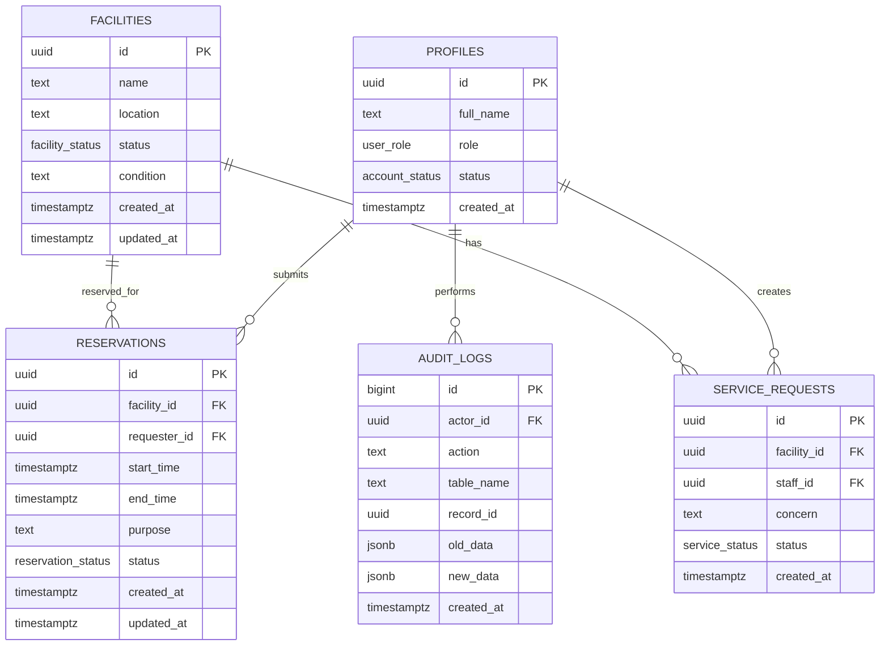
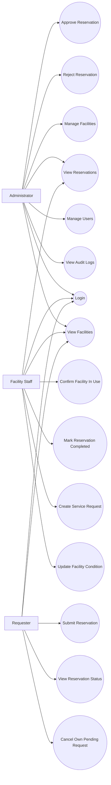
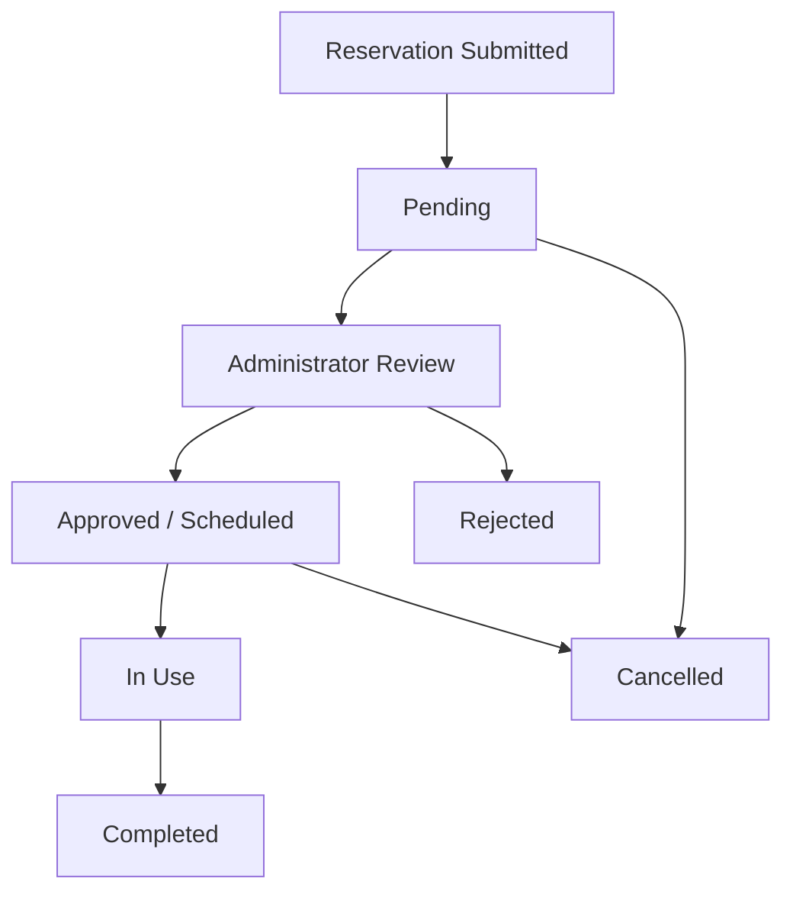

# Diagrams

Use these Mermaid diagrams for the report. GitHub can render Mermaid diagrams in Markdown preview, so you can screenshot them after pushing to GitHub.

## ERD

## Use Case Diagram

## Reservation Workflow

